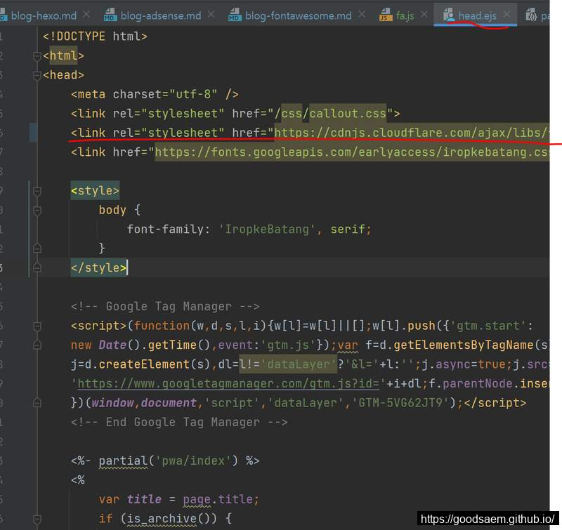
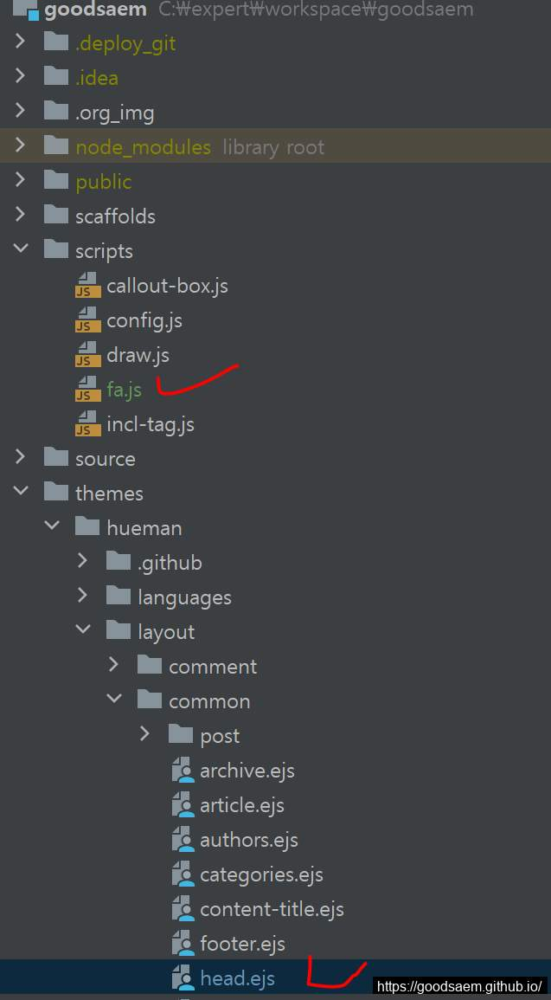


fontawesome 라이브러리가 너무 오래되어 2025-06-25 15:18:58 기준
기존 hexo-tag-fontawesome 플러그인을 사용하는 방식에서 
사용자 플러인을 추가하는 방식으로 변경함



##  개요
Font Awesome은 블로그 글이나 템플릿 안에서 아이콘을 손쉽게 삽입할 수 있도록 도와주는 
아이콘 폰트 라이브러리 이다. Hexo에서 Font Awesome 사용하는 방법에 대해서 정리한다.

## 사용자 플러그인 추가
scritps/fa.js를 아래와 같이 코딩한다.
```javascript
hexo.extend.tag.register('fa', function(args) {
    if (!args.length) return '';

    const icon = args[0];
    let size = '';
    let style = 'solid';
    const extraClasses = [];

    const sizes = ['lg', 'xl', '1x', '2x', '3x', '4x', '5x', '6x', '7x', '8x', '9x', '10x', '2xl'];
    const styles = ['solid', 'regular', 'brands'];
    const rotations = ['rotate-90', 'rotate-180', 'rotate-270'];
    const animations = ['spin', 'pulse', 'spin-pulse', 'spin-reverse', 'beat', 'beat-fade']; // ← 여기에 추가
    const flips = ['flip-horizontal', 'flip-vertical'];
    const others = ['border', 'fw', 'inverse'];

    args.slice(1).forEach(arg => {
        if (sizes.includes(arg)) {
            size = arg;
        } else if (styles.includes(arg)) {
            style = arg;
        } else if (rotations.includes(arg) ||
            animations.includes(arg) ||
            flips.includes(arg) ||
            others.includes(arg)) {
            extraClasses.push(`fa-${arg}`);
        }
    });

    return `<i class="fa-${style} fa-${icon}${size ? ' fa-' + size : ''}${extraClasses.length ? ' ' + extraClasses.join(' ') : ''}"></i>`;
}, { ends: false });
```

## 최신 라이브러리 테마에 추가
themes\hueman\layout\common\head.ejs 파일에 아래 내용을 추가한다.
```html
<link rel="stylesheet" href="https://cdnjs.cloudflare.com/ajax/libs/font-awesome/6.7.2/css/all.min.css" integrity="sha512-Evv84Mr4kqVGRNSgIGL/F/aIDqQb7xQ2vcrdIwxfjThSH8CSR7PBEakCr51Ck+w+/U6swU2Im1vVX0SVk9ABhg==" crossorigin="anonymous" referrerpolicy="no-referrer" />
```


## 수정한 파일 디렉토리 구조



## 사용법
아래와 같이 fa 하고 아이콘 이름을 넣고 옵션을 추가하면 된다.
```html

```

### 기본
```html
 유저 아이콘 출력
```
 유저 아이콘 출력

### 아이콘 크기
```html
 유저 아이콘 크기 1x
 유저 아이콘 크기 2x
 유저 아이콘 크기 3x
 유저 아이콘 크기 4x
 유저 아이콘 크기 5x
 유저 아이콘 크기 6x
 유저 아이콘 크기 7x
 유저 아이콘 크기 8x
 유저 아이콘 크기 9x
 유저 아이콘 크기 10x
```

1.  유저 아이콘 크기 1x
1.  유저 아이콘 크기 2x
1.  유저 아이콘 크기 3x
1.  유저 아이콘 크기 4x
1.  유저 아이콘 크기 5x
1.  유저 아이콘 크기 6x
1.  유저 아이콘 크기 7x
1.  유저 아이콘 크기 8x
1.  유저 아이콘 크기 9x
1.  유저 아이콘 크기 10x

### 아이콘 유형
```html
 유저 아이콘 solid
 유저 아이콘 regular
```
-  유저 아이콘 solid
-  유저 아이콘 regular

### 아이콘 회전
```html
 무회전
 90도 회전
 180도 회전
 270도 회전
 수평방향 회전
 수직방향 회전
 수평수직방향 회전
```
-  무회전
-  90도 회전
-  180도 회전
-  270도 회전
-  수평방향 회전
-  수직방향 회전
-  수평수직방향 회전

### 아이콘 스타일링
```html
<span style="font-size: 3em; color: Tomato;">
  
</span>

<span style="font-size: 48px; color: Dodgerblue;">
    
</span>

<span style="font-size: 3rem;">
  <span style="color: Mediumslateblue;">
    
  </span>
</span>
```
<span style="font-size: 3em; color: Tomato;">
  
</span>

<span style="font-size: 48px; color: Dodgerblue;">
  
</span>

<span style="font-size: 3rem;">
  <span style="color: Mediumslateblue;">
    
  </span>
</span>

### 아이콘 애니메이션
```html


```




---

## 전체 무료 사용가능 아이콘 리스트
아이콘을 클릭하면 hexo 에서 사용 가능하도록 태그가 복사된다.

