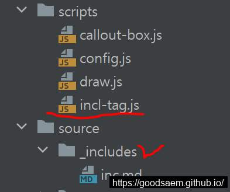

# Hexo 에 글 포함하기
Hexo 로 글을 쓰다가 이전글을 포함해서 글을 쓰는 경우가 생겼다.
예를 들어 vue 설치 글을 쓴다고 가정하자. 그럼 우선 node.js 를 설치를 진행해야 한다.
node.js 설치하는 문서는 이미 만들었다고 가정한다면  보통의 경우에는 vue 설치 과정만
설명을 하고 node.js 설치하는 방법은 링크를 걸어 보여주도록 한다. 하지만 이건
페이지를 벗어나야 되기 때문에 좋은 방법은 아니라고 생각한다.

신규 쓰는 페이지에 다른 페이지 내용을 포함할수 있을까? 그러면 블로거는 글을
중복해서 쓸필요가 없어지고 블로그를 이용하는 사용자도 한번에 읽어 나가니까
편하지 않을까 ?

include 가 될까? 한번 해보자!!!

## 계속 테스트
계속 테스트를 해보았지만 생각처럼 동작하지 않았다.
여러번의 시행착오 끝에 포함시킬수 있었다.
그내용을 정리한다.

## hexo 에 글 include 방법

- 필요한 라이브러리 추가
```
npm install markdown-it
```
- 폴더구조는 아래와 같다.
 _includes 폴더에 post에 포함할 내용을 inc.md 처럼 만들어서 넣고
 scripts 폴더에는 확장 tag를 정의한다.
 
- scripts에 incl-tag.js 추가

*incl* 이란 tag를 확장하여 추가하고 _includes 폴더에서 전달받은 이름의 markdown(md)
파일을 찾아서 markdown을 다시 html로 변환한값을 리턴한다.

```js incl-tag.js
const fs = require('fs');
const path = require('path');
const md = require('markdown-it')();

hexo.extend.tag.register('incl', function(args) {
    const name = args[0];
    const filePath = path.join(hexo.source_dir, '_includes', `${name}.md`);
    if (!fs.existsSync(filePath)) {
        return `<!-- include not found: ${name} -->`;
    }
    const content = fs.readFileSync(filePath, 'utf8');
    return md.render(content);
}, { async: false });
```
- package.json 파일에 prehexo 추가
```json package.json
... 중략 ...
  "scripts": {
    "prehexo": "node scripts/incl-tag.js",
    "build": "hexo generate",
    "clean": "hexo clean",
    "deploy": "hexo deploy",
    "server": "hexo server"
  },
... 중략 ...  
```
- 인클루드 하고자하는 페이지에서 _includes 에 있는 inc 파일 include
```md markdown

```
- inc.md 파일이 아래와 같이 코딩되어 있다면
```markdown
# inc.md

여기부터는 inc.md 파일 내용이다.


여기까지 inc.md 파일 내용이다.
```
- 아래와 같이 include 내용이 출력된다.
