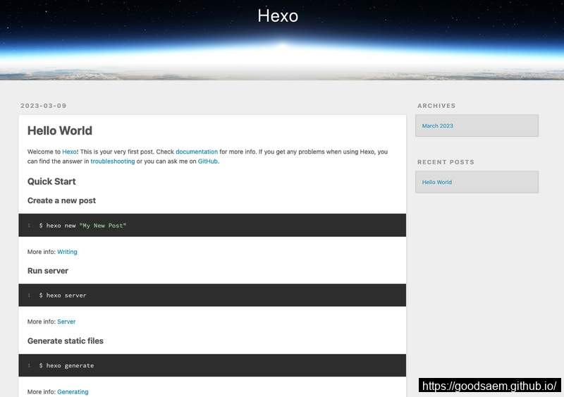
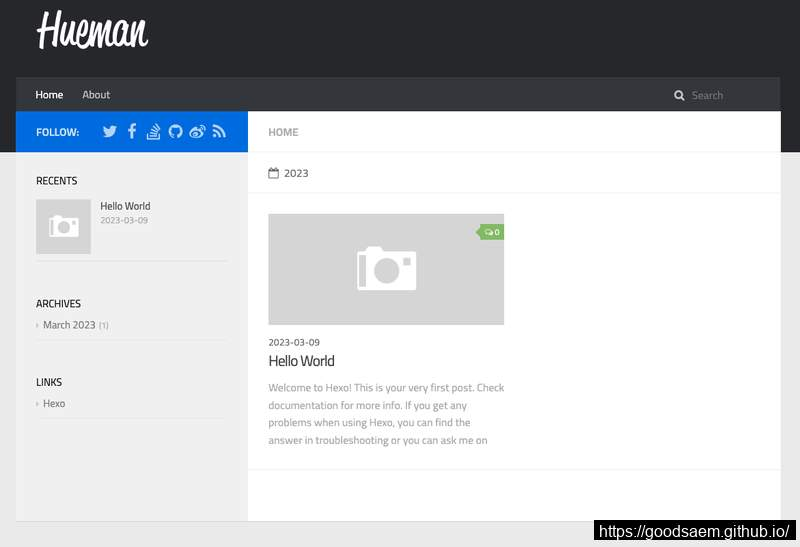
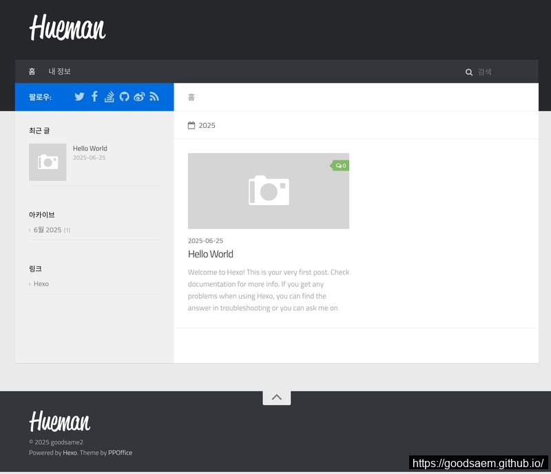

## 개요

정적 웹사이트 생성기 hexo 를 이용하여 블로그를 만든후 github page 까지 반영하는 방법에 대해서
정리한다. 정적 웹사이트 블로그를 만들면서 작업했던 내용들을 정리했으며 이글로 기술자료를 정리하는
개발자들에게 도움이 되었으면 한다.



한동안 방치해둔 블로그를 다시 정리하고 있다. 글을 정리하면서 나에게 도움이 되고 글을 읽고 있는 
분에게도 도움이 되었으면 한다. 글을 다시 정리하면서 많은 부분 변경하고 새로운 내용들도 추가했다.
다 정리할수 있을까 걱정도 되지만 최대한 적어 보고자 한다.
_글수정일 : 2025-06-22 오후 6:48_



## 설치순서
설치 순서는 아래와 같다. 사전 준비사항으로 GitHub 계정생성하고 Git 설치하고 Node.js 설치하는
과정 있는데 이부분은 예전에 만들어 놓은 페이지가 있어 이부분을 참조하면 될것 같은데 정리하는
차원에서 그대로 진행하면서 정리하겠음.



위에 순서도는 draw.io로 그렸고 플러그인을 추가하여 웹사이트에서도 볼수 있게 했다.
예전에는 이런 시도를 하지 않았는데 경험이 늘어남에 따라 표현하는 부분도 많아지는듯한다.

 
## 사전준비사항





github 계정 생성을 위해서는 메일주소가 있어야함 메일 계정이 있는  
분들은 skip 할것 (protonmail 에서 무료 메일 발급)









## hexo 설치

아래 명령어를 입력하여 전역으로 hexo-cli 설치
```shell
npm install hexo-cli -g
```

아래 명령어를 입력하여 hexo blog를 생성한다.
```shell
hexo init blog
```

아래 명령어를 입력하여 hexo server 실행
```shell
cd blog
npm install
hexo server
```

http://localhost:4000/ 접속해서 아래와 같은 화면이 나오면 설치 완료



## hexo 테마 적용하기

https://hexo.io/themes/ 에서 hexo 다양한 테마를 다운로드 받을수 있다.
본 블로그에서 사용하는 theme은 https://github.com/ppoffice/hexo-theme-hueman 은 이용했고 
가장 최근 버전은  2020년 6월 21일 릴리즈된 0.5.0 버전이다.

### 설치
설치는 https://github.com/ppoffice/hexo-theme-hueman/wiki/Installation 문서를 보고 참고함

먼저 프로젝트를 blog 폴더 아래에 themes/hueman 로 복제함
```shell
cd blog
git clone https://github.com/ppoffice/hexo-theme-hueman.git themes/hueman
```

실행결과
```shell
Cloning into 'themes/hueman'...
remote: Enumerating objects: 2277, done.
remote: Counting objects: 100% (16/16), done.
remote: Compressing objects: 100% (14/14), done.
remote: Total 2277 (delta 3), reused 11 (delta 2), pack-reused 2261
Receiving objects: 100% (2277/2277), 5.77 MiB | 6.42 MiB/s, done.
Resolving deltas: 100% (1218/1218), done.
```

blog 폴더의 _confi.yml파일에서 theme을 파일을 열어서 아래와 같이 설치한 theme명으로 수정한다

~~theme: landscape~~
```shell
... 중략 ...
# Extensions
## Plugins: https://hexo.io/plugins/
## Themes: https://hexo.io/themes/
theme: hueman
... 중략 ...
```
themes\hueman 디렉토리로 이동한후 _config.yml.example 파일일 _config.yml로 수정한다.
```shell
cd themes/hueman
mv _config.yml.example _config.yml
```

### 실행
상위 디렉토리로 이동한후 hexo 서버를 구동시킨다.
```shell
cd ..
cd ..
hexo server
```

실행결과
```shell
INFO  Validating config
INFO  Start processing
INFO  Hexo is running at http://localhost:4000/ . Press Ctrl+C to stop.
```
웹브라우저에서 url http://localhost:4000/ 를 입력하고 아래와 같은 그림이 나오면 성공 



## hexo 환경설정
블로그 환경설정을 위해  blog/_config.xml 파일을 아래와 같이 수정함.

### 사이트및 url 정보
```properties
# Site
title: goodsame2
subtitle: goodsaem2 블로그 입니다.
description: 블로그 테스트를 위해서 환경설정한 내용입니다.
keywords:
author: goodsame2
language: ko
timezone: asia/seoul

# URL
## Set your site url here. For example, if you use GitHub Page, set url as 'https://username.github.io/project'
url: https://goodsame2.github.io/
```
### github 에 배포를 위한 deploy 정보
```properties
# Deployment
## Docs: https://hexo.io/docs/one-command-deployment
deploy:
  type: git
  repo: git@github.com:goodsame2/goodsame2.github.io.git
  branch: main
```

## 배포하기

### 준비물
배포를 위해 hexo-deployer-git 플러그인을 설치한다. 설치명령어는 아래와 같다.
```shell
npm install hexo-deployer-git --save
```
### 배포순서
배포는 먼저 정적인 페이지(html)를 만들고 github page 쪽으로 deploy 하는 형태로 진행한다.
```flow
st=>start: 시작
e=>end: 종료
op1=>operation: 정적인 페이지만들기
op2=>operation: 배포하기
st(right)->op1(right)->op2(right)->e(right)
```

### 정적 페이지 만들기

먼저 배포될 디렉토릴 파일을 깨끗히 정리한다.
```shell
hexo clean
```
실행결과

```shell
INFO  Validating config
INFO  Deleted database.
INFO  Deleted public folder.
```

아래 명령어를 입력하여 정적 페이지를 생성한다.
```shell
hexo generate
```
정상적으로 실행되면 아래와 같이 public 디렉토리에 블로그 구성을 필요한 파일들이 생성됨을 확인할수 있다.
```shell
.. 중략 ...
INFO  Generated: archives/2023/index.html
INFO  Generated: archives/index.html
INFO  Generated: index.html
.. 중략 ...
INFO  80 files generated in 314 ms
```

### 배포하기
아래 명령어를 입력하여 github page 에 배포한다.

```shell
hexo deploy
```

실행결과
```shell
INFO  Validating config
INFO  Deploying: git
INFO  Clearing .deploy_git folder...
INFO  Copying files from public folder...
INFO  Copying files from extend dirs...
[main 1ca47fb] Site updated: 2023-03-10 23:41:16
 12 files changed, 1 insertion(+), 2826 deletions(-)
 .. 중략 ...
INFO  Deploy done: git
```

## Github page 확인하기
여기까지 진행했다면 https://goodsame2.github.io/  사이트에 접속하면 아래와 같은 화면을 확인할수 있다.


