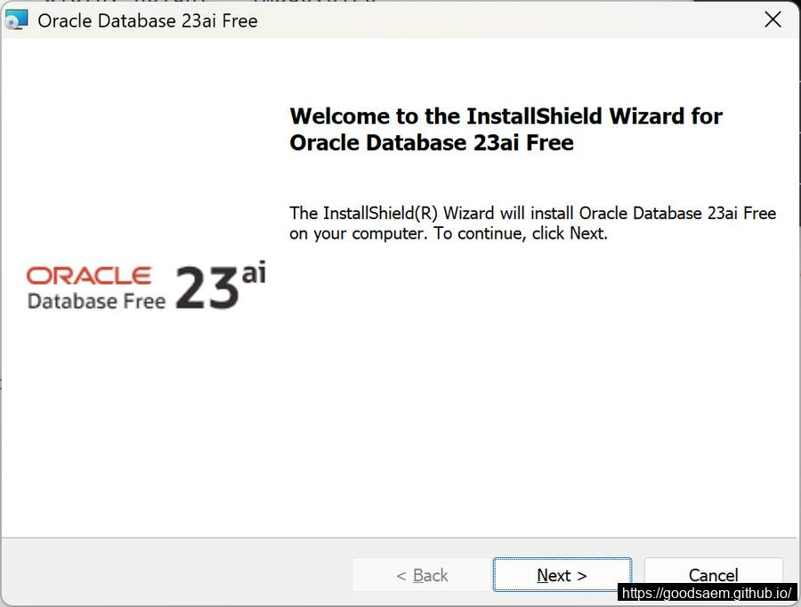
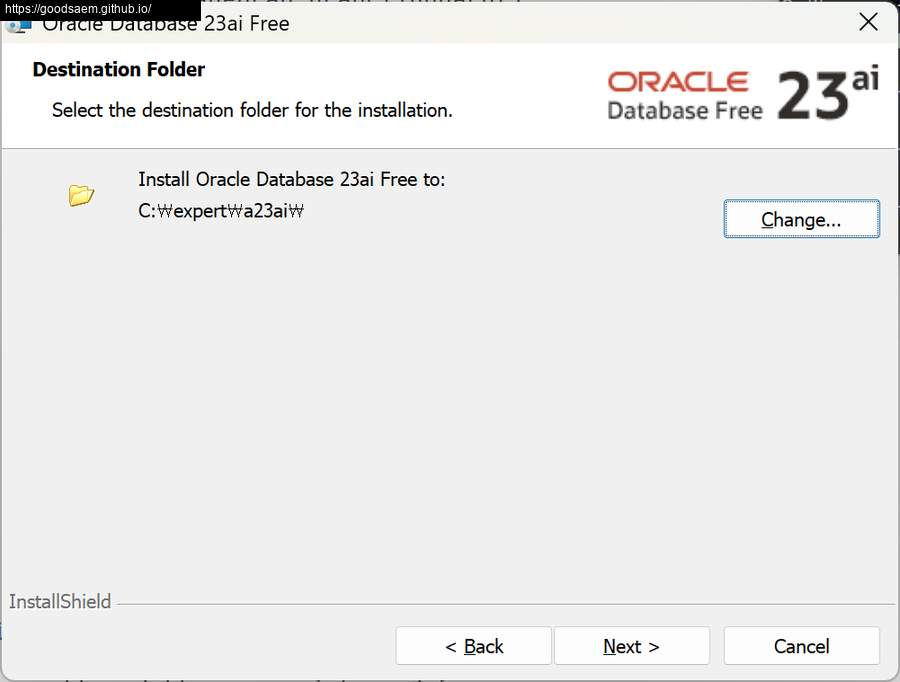
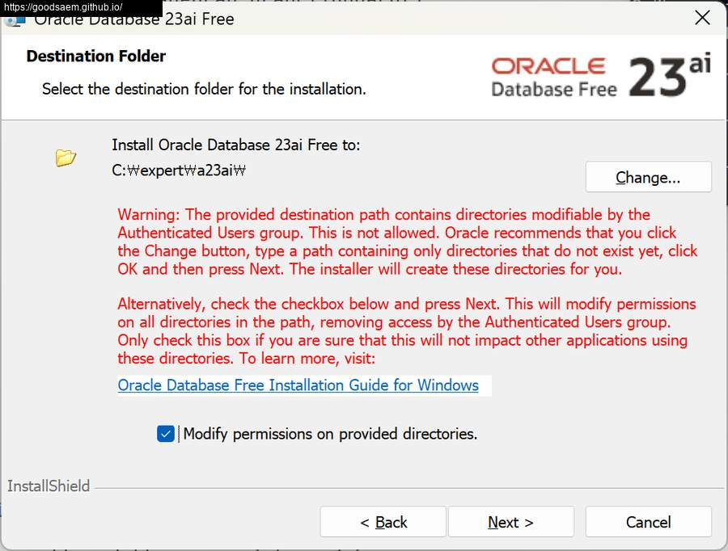
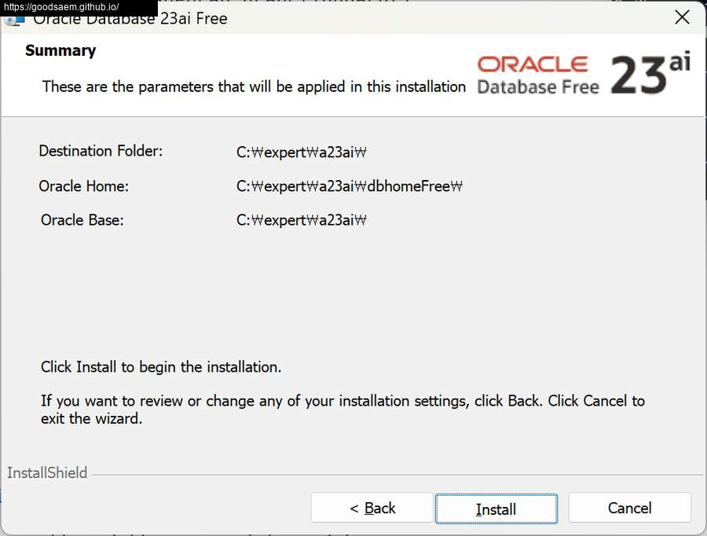
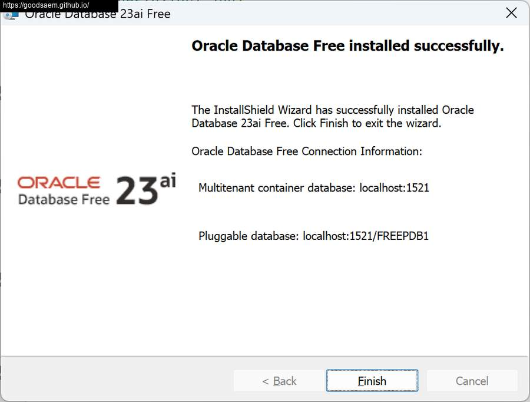

# Oracle Database 23 ai 주요 내용 정리

---

## 1. Oracle Database 23 ai 소개

Oracle Database 23 ai는 무료 경량화 데이터베이스 버전이다. 개발, 학습, 소규모 상용 환경에서 무료로 사용 가능하며, 제한된 자원 내에서 Oracle Database 핵심 기능을 제공한다.

---

## 2. 시스템 요구 사항

- 최소 2GB RAM
- 최소 10GB 디스크 공간
- x86-64 CPU, 최대 2개 CPU 스레드 지원
- 지원 OS: Windows 10, 11, Windows Server 2019/2022 (64비트), Oracle Linux 8/9, RHEL 8/9, CentOS Stream 8
- Linux는 glibc 2.28+, kernel 4.18+ 필요
- 권장 파일시스템: Linux ext4/xfs, Windows NTFS
- 포트 1521 사용 가능해야 함
- Oracle Instant Client 포함, 별도 JDK 필요 없음
- 가상화 및 컨테이너 환경 지원

---

## 3. 라이선스 제한 사항

- 완전 무료, 상업적 사용 가능
- 자원 제한: 최대 2GB RAM, 2 CPU 스레드, 2GB 사용자 데이터, 12GB DB 총 크기
- 서버당 하나의 XE 인스턴스만 실행 가능
- 제한 우회, 다중 XE 실행 금지
- XE로 개발한 애플리케이션은 상위 Oracle 버전으로 마이그레이션 가능

---

## 4. 설치 방법

- Windows: EXE 실행, 관리자 암호 설정 후 자동 시작
- Linux: RPM 설치 + 초기화 스크립트 실행
- 서비스 상태 확인 및 관리 (Windows: `net start/stop`, Linux: `systemctl`)
- 기본 포트 1521, 5500 사용
- 방화벽/SELinux 설정 확인 필요
- 제거: Windows 제어판 또는 `setup.exe /deinstall`, Linux `dnf remove`

---

## 5. Windows에서 True Cache 구성

- 클라이언트 캐싱 기능으로 응답 속도 향상
- `truecache.xml`에서 캐시할 SQL과 TTL 설정
- 환경 변수 및 `sqlnet.ora` 수정 필요
- 캐시 디렉토리 생성 후 클라이언트 재시작
- SELECT 쿼리만 캐시 가능

---

## 6. 데이터베이스 연결 방법

- SQL\*Plus:
  ```bash
  sqlplus sys as sysdba
  sqlplus hr/hr_password@localhost/XEPDB1

---

# 설치

---

## 파일을 다운로드 받는다.

- 다운로드 url : https://www.oracle.com/kr/database/free/get-started/
- 다운로드 파일 : https://download.oracle.com/otn-pub/otn_software/db-express/WINDOWS.X64_238000_free.zip

## 다운로드 받은 파일의 압축을 풀고 설치를 진행한다.

- Next 버튼 클릭



- Next 버튼 클릭


- I accept the terms in the license agreement 선택후 Next 버튼 클릭


- 설치 경로를 변경하고 Next 버튼 클릭



- 정말 수정할거냐고 물어보는데 체크하고 Next 버튼 클릭



- 관리자 암호 입력하고 Next 버튼 클릭


- Install 버튼 클릭



- 설치 진행중


- 설치완료


