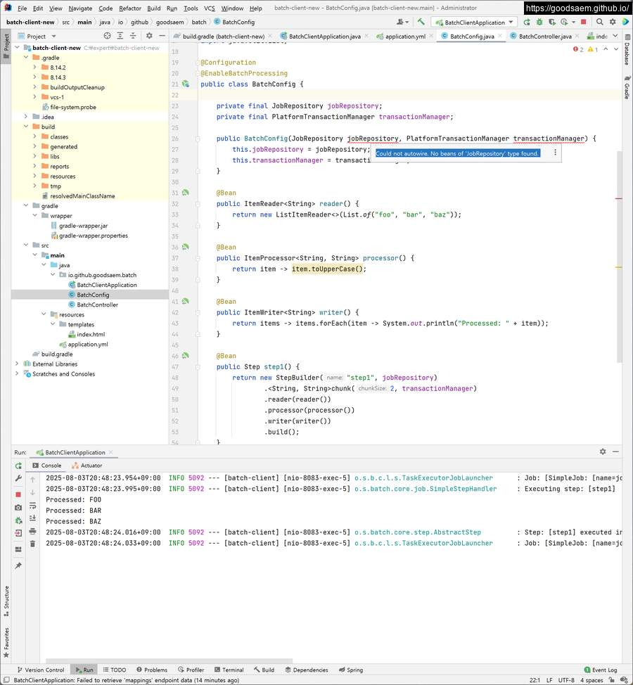
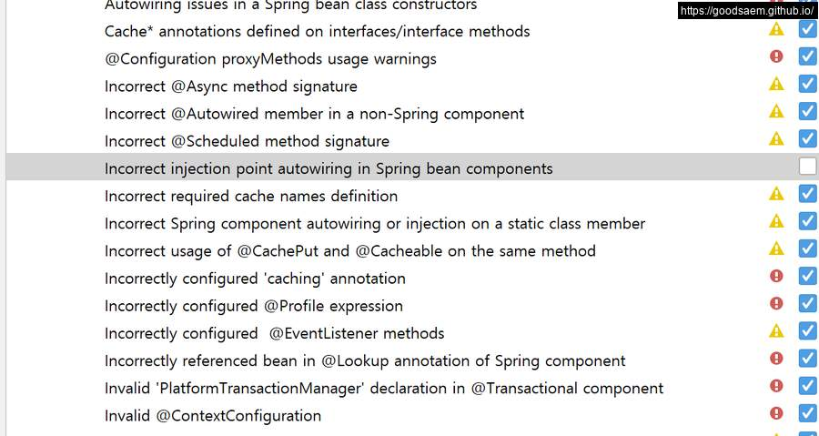
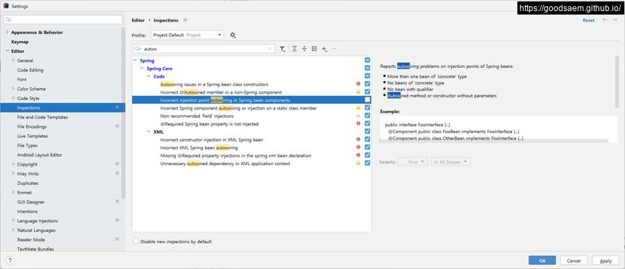
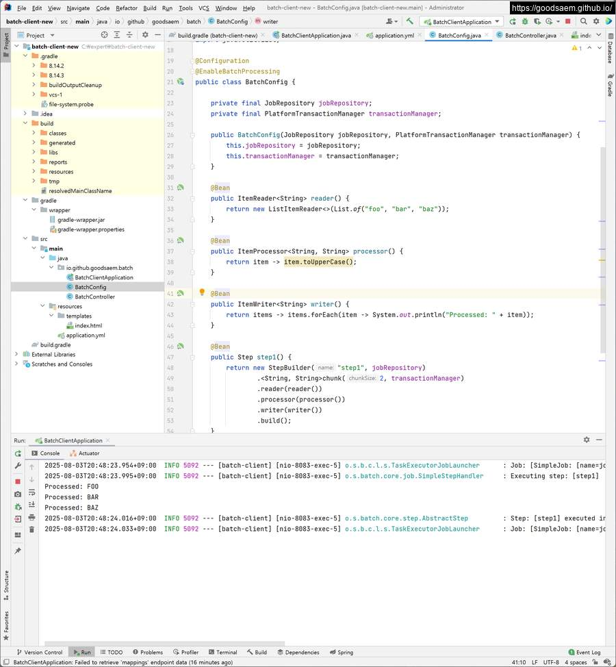

# 개요
인텔리제이에서 프로젝트 실행은 잘되는데 Could not autowire. No beans of 'xxxxx' type found. 
에러가 뜨면서 빨갛게 밑줄이 그려졌다. 생성자 bean 추가하라는둥 여러가지 방법을 해보았지만
에러는 사라지지 않았고 아래 url을 보니 나와 같은 현상이 있는 분이 있어 읽어 보니
무시하고 옵션을 끄라고 하여 문제를 해결했다.

https://youtrack.jetbrains.com/issue/IDEA-316836/After-IDEA-is-upgraded-to-2023.1-it-prompts-an-error-Could-not-autowire.-No-beans-of-xxx-type-found.

- 문제의 에러 Could not autowire. No beans of 'JobRepository' type found.

- File > Editor > inspection 에서 autow 라고 검색하면 
Incorrect injection point autowiring in Spring bean componets 항목에 빨간색 ! 로 되어 있는데
이부분을 그림과 같이 체크 해제 한다.

- 그러면 아래와 같이 문제가 해결됨을 확인할수 있다.

