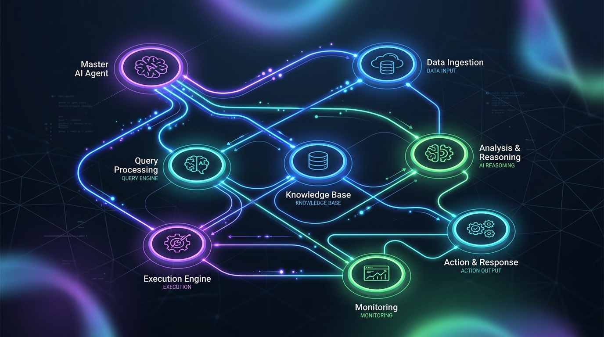

LangGraph는 LLM 기반의 에이전트 워크플로우를 **순환 그래프(Cyclic Graph)** 구조로 설계하고 제어할 수 있게 돕는 강력한 프레임워크입니다. 

기초 개념부터 시작하여 실무 수준의 멀티 에이전트 아키텍처 및 모니터링까지 유기적으로 학습할 수 있도록 단계별 공부 로드맵이자 블로그 연재 목차를 제시합니다.

---

## **Part 1. LangGraph의 이해와 시작 (기초 편)**
LLM 에이전트의 흐름을 왜 그래프로 정의해야 하는지 알아보고, 개발 환경을 설정하여 첫 그래프를 작성합니다.

*   **1.1 에이전트 아키텍처의 진화**
    *   Linear Chain(LangChain Express)의 한계와 흐름 제어의 필요성
    *   왜 DAG(비순환 그래프)를 넘어 순환(Loops/Cycles) 구조가 필요한가?
    *   LangGraph란 무엇이며 어떤 문제를 해결하는가?
*   **1.2 LangGraph 핵심 3대 개념**
    *   **State (상태)**: 모든 노드가 공유하고 업데이트하는 전역 스키마 정의 방법
    *   **Nodes (노드)**: LLM 호출, 도구 실행 등 실제 작업을 수행하는 액터
    *   **Edges (엣지)**: 다음으로 실행할 노드를 결정하는 제어 흐름 (일반 엣지와 조건부 엣지)
*   **1.3 Hello LangGraph! 첫 에이전트 구현**
    *   환경 설정 (Python, LangChain, API Key 설정)
    *   가장 단순한 Chatbot Graph 구현하기
    *   생성된 그래프 시각화하기 (`pygraphviz` 및 이미지 출력 방법)

---

## **Part 2. 상태 관리와 도구 활용 (중급 편)**
상태(State)를 더 유연하게 다루고 외부 API/도구를 에이전트에 결합하는 실전 방법을 다룹니다.

*   **2.1 State Graph 깊이 파헤치기**
    *   `StateGraph` 정의와 상태 타입 설정
    *   상태 갱신 법칙: 덮어쓰기(Overwrite) vs 누적/병합(Reducer 함수 활용)
    *   타입 안정성을 위한 Pydantic 스키마 활용
*   **2.2 Tool Calling 에이전트 설계**
    *   LLM에 도구 바인딩하기
    *   도구 실행 노드(`ToolNode`) 커스텀 정의 및 표준 라이브러리 활용
    *   실행 흐름 분기: 조건부 엣지(`Conditional Edge`) 기반의 라우팅 처리

---

## **Part 3. 인간 개입과 장기 기억 관리 (실무 핵심 편)**
현업 에이전트 시스템에서 가장 중요한 신뢰성 확보 장치인 Human-in-the-loop과 대화 보존을 다룹니다.

*   **3.1 Persistence & Memory (지속성 및 메모리)**
    *   `Checkpointer`를 활용한 대화 세션 및 상태 저장
    *   Memory와 Thread의 개념: 여러 사용자 관리
*   **3.2 Human-in-the-loop (인간 개입 루프)**
    *   에이전트 동작 일시 중지(Interrupt) 및 사용자 피드백 대기
    *   민감한 도구 실행 전 승인(Approval) 단계 설계하기
    *   **Time Travel (시간 여행)**: 과거 상태로 되돌아가서 다시 실행(Replay)하거나 상태 수정(Fork)하기

---

## **Part 4. 대규모 워크플로우 설계 (고급 편)**
실무 복잡성을 견딜 수 있는 멀티 에이전트 구조와 최적화 기법을 다룹니다.

*   **4.1 Multi-Agent Systems (멀티 에이전트 협업)**
    *   싱글 에이전트의 한계 극복하기
    *   네트워크 토폴로지: 조정자 방식(Supervisor) 대 계층적(Hierarchical) 협업 방식
    *   에이전트 간 상태 전송 및 공유 채널 설계
*   **4.2 스트리밍(Streaming) 구현**
    *   토큰 단위 스트리밍(LLM Token Streaming)
    *   노드 및 상태 업데이트 단위 스트리밍(Node/State Streaming)
    *   사용자 경험(UX)을 고려한 실시간 응답 처리

---

## **Part 5. 모니터링 및 실무 배포 (프로덕션 편)**
애플리케이션을 완성한 후 실제 서비스 환경으로 이전하는 실무 파이프라인을 다룹니다.

*   **5.1 LangSmith를 활용한 디버깅 및 평가**
    *   그래프 실행 추적(Tracing)과 병목 구간 분석
    *   에이전트 성능 평가셋 구성 및 정량적 평가
*   **5.2 LangGraph Studio & Cloud**
    *   LangGraph Studio를 활용한 비주얼 디버깅 및 시뮬레이션
    *   LangGraph Cloud를 활용한 서버리스 에이전트 API 배포
    *   독립형 인프라 구축을 위한 FastAPI 래핑 및 배포 패턴

---

## **Part 6. 정리 및 베스트 프랙티스**
*   프로젝트에 LangChain 단독 도입 vs LangGraph 결합 기준 기준표
*   복잡한 그래프 설계를 단순하게 유지하는 설계 철학(Clean Graph Architecture)
