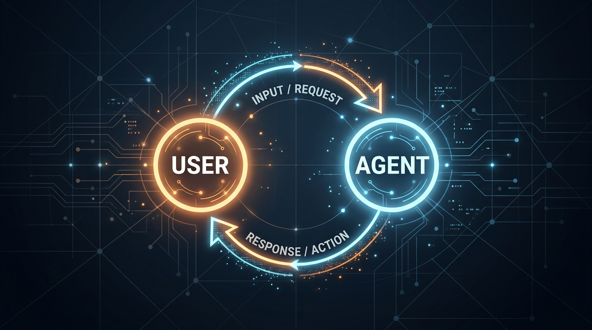
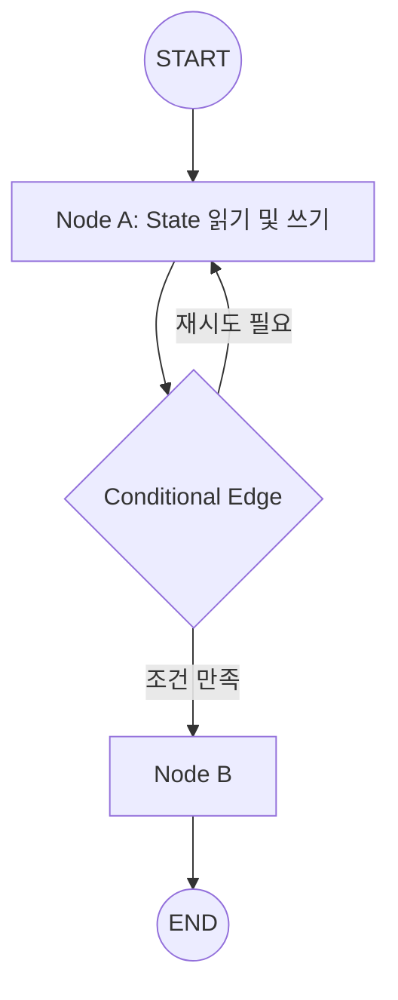

AI 에이전트를 개발할 때, 단순한 일자형 파이프라인(Chain)을 넘어 사용자의 피드백을 받거나 에러 발생 시 이전 단계로 되돌아가는 등의 **순환(Loop) 구조**가 필수적인 순간이 옵니다. 

이번 글에서는 LangChain 생태계의 대표적인 순환 그래프 설계 도구인 **LangGraph**의 도입 배경부터 핵심 개념, 그리고 간단한 첫 번째 에이전트를 직접 코딩해보는 실습까지 알아보겠습니다.

---

## 1. 에이전트 아키텍처의 진화

### 1.1 Linear Chain(LangChain Express)의 한계
초기의 LLM 애플리케이션은 **사용자 입력 -> 프롬프트 템플릿 -> LLM 호출 -> 파싱 -> 출력**의 단방향 흐름(Linear Chain)으로 구성되었습니다. 
하지만 실제 비즈니스 로직이나 정교한 에이전트를 구축할 때는 다음과 같은 한계에 부딪힙니다.
- **의사 결정에 따른 분기 불가능**: LLM의 응답에 따라 다른 도구를 실행하거나 이전 단계로 분기하기 어렵습니다.
- **예외 처리 부재**: API 호출이 실패하거나 올바르지 않은 형식이 반환되었을 때, 다시 LLM에게 수정 요청을 보내는 루프를 돌릴 수 없습니다.

### 1.2 왜 순환(Loops/Cycles) 구조가 필요한가?
진정한 에이전트는 바둑을 두거나 코드를 수정하듯이 **"행동(Action) -> 관찰(Observation) -> 재판단(Reasoning)"**의 과정을 반복할 수 있어야 합니다. 
비순환 그래프(DAG, Directed Acyclic Graph) 프레임워크로는 이러한 반복 루프(Cycle)를 구현하기 매우 까다롭습니다. LangGraph는 바로 이 **순환 루프를 일급 시민(First-class citizen)으로 지원**하기 위해 탄생했습니다.

---

## 2. LangGraph 핵심 3대 개념

LangGraph의 아키텍처는 크게 **State, Nodes, Edges** 세 가지로 이루어집니다.



### 2.1 State (상태)
그래프의 노드들이 서로 공유하는 **전역 데이터베이스**입니다. 
- Python의 `TypedDict`나 `Pydantic` 클래스로 스키마를 정의합니다.
- 각 노드는 실행을 마치고 이 State에 새로운 값을 쓰거나 업데이트(Reducer를 통해 기존 메시지에 병합)할 수 있습니다.

### 2.2 Nodes (노드)
실제 작업을 담당하는 **독립적인 함수**입니다.
- 함수는 인자로 현재 `State`를 전달받고, 수행 결과를 `dict` 형태로 리턴하여 `State`를 갱신합니다.
- 예: LLM에게 질문하는 노드, 검색 API를 호출하는 노드 등.

### 2.3 Edges (엣지)
노드와 노드 사이의 **실행 흐름 경로**를 정의합니다.
- **Normal Edge (일반 엣지)**: A 노드가 끝나면 무조건 B 노드로 이동합니다. (`graph.add_edge("A", "B")`)
- **Conditional Edge (조건부 엣지)**: LLM의 판단이나 특정 조건 함수(Router)의 반환 결과에 따라 다음 노드를 결정합니다.

---

## 3. Hello LangGraph! 첫 에이전트 구현

가장 단순하면서도 상태 관리가 동작하는 챗봇 그래프를 직접 작성해 보겠습니다. 본 실습에서는 빠른 패키지 관리를 위해 **uv**를 사용하고, LLM 모델로는 Google의 **Gemini**를 연동합니다.

### 3.1 필수 라이브러리 설치 및 환경 설정

먼저 프로젝트 가상환경에 필요한 패키지들을 설치하고 API 키를 설정합니다.

```bash
# uv를 통해 필요한 패키지들을 가상환경에 추가합니다.
uv add langgraph langchain-google-genai python-dotenv ipython
```

프로젝트 루트 또는 실행 디렉토리에 `.env` 파일을 생성하고 발급받은 Gemini API 키를 설정합니다.

```ini
# .env
GEMINI_API_KEY=your_gemini_api_key_here
```

### 3.2 에이전트 소스 코드 작성 (`simple_agent.py`)

그래프 빌딩과 스트리밍 대화 실행, 그리고 그래프 시각화(PNG 파일 저장)까지 포함된 최종 실습 코드입니다.

```python
import os
from typing import Annotated
from typing_extensions import TypedDict
from dotenv import load_dotenv
from langgraph.graph import StateGraph, START, END
from langgraph.graph.message import add_messages
from langchain_google_genai import ChatGoogleGenerativeAI

# .env 파일 로드 (OpenAI 및 Google API 키 등 설정)
load_dotenv()

# 1. State(상태) 정의
class State(TypedDict):
    # add_messages는 새로운 메시지 객체를 기존 메시지 리스트에 누적(append)해주는 리듀서입니다.
    messages: Annotated[list, add_messages]

# 2. Graph 빌더 생성
graph_builder = StateGraph(State)

# 3. LLM 선언 및 챗봇 노드(Node) 함수 정의
llm = ChatGoogleGenerativeAI(model="gemini-2.5-flash", temperature=0)

def chatbot(state: State):
    # 현재 상태에 축적된 메시지들을 전달해 LLM을 호출하고, 결과를 반환합니다.
    response = llm.invoke(state["messages"])
    return {"messages": [response]}

# 그래프 빌더에 노드 등록
graph_builder.add_node("chatbot", chatbot)

# 4. 흐름(Edge) 정의
# START에서 출발하여 chatbot 노드로 향하고, chatbot 노드가 끝나면 END(종료)로 향합니다.
graph_builder.add_edge(START, "chatbot")
graph_builder.add_edge("chatbot", END)

# 5. 그래프 컴파일
graph = graph_builder.compile()
print("[OK] 그래프 컴파일 완료!")


# 스트리밍 실행 예제
initial_input = {"messages": [("user", "안녕하세요! LangGraph의 핵심 특징 3가지만 알려주세요.")]}

events = graph.stream(initial_input)
for event in events:
    for value in event.values():
        print("\n[Assistant]")
        print(value["messages"][-1].content)


# 6. 그래프 시각화하기 (Graph Visualization)
from IPython.display import Image, display

try:
    # Mermaid.js API를 통해 그래프 구조를 PNG 이미지로 생성 및 출력합니다.
    png_data = graph.get_graph().draw_mermaid_png()
    with open("graph_structure.png", "wb") as f:
        f.write(png_data)
    print("[OK] 그래프 구조를 'graph_structure.png'로 저장했습니다.")
except Exception as e:
    print("시각화 도구 실행 실패:", e)
```

### 3.3 에이전트 실행 결과

터미널에서 `uv run` 명령어로 스크립트를 실행한 결과 출력 로그는 다음과 같습니다. 정상적으로 에이전트의 응답이 스트리밍되고, 폴더 내에 시각화 이미지 파일(`graph_structure.png`)이 정상 저장됩니다.

```bash
PS D:\coffeeman1\python> uv run .\simple_agent.py
[OK] 그래프 컴파일 완료!

[Assistant]
안녕하세요! LangGraph의 핵심 특징 3가지는 다음과 같습니다.

1.  **그래프 기반 워크플로우 (Graph-based Workflow):**
    *   LLM 애플리케이션의 복잡한 로직을 **노드(단계)**와 **엣지(전환)**로 구성된 그래프 형태로 정의할 수 있습니다. 이를 통해 시각적으로 명확하고 관리하기 쉬운 구조를 만들며, 복잡한 에이전트의 흐름을 직관적으로 설계할 수 있습니다.

2.  **상태 관리 및 반복 (State Management & Iteration/Loops):**
    *   각 단계에서 애플리케이션의 현재 **상태(State)**를 유지하고 업데이트할 수 있습니다. 이는 LLM이 이전 대화나 작업 결과를 기억하고, 필요에 따라 특정 단계로 다시 돌아가 반복 작업을 수행하거나 자체 수정(self-correction)하는 데 필수적입니다.

3.  **조건부 라우팅 (Conditional Routing):**
    *   특정 조건(예: LLM의 응답, 도구 사용 결과 등)에 따라 다음으로 진행할 노드를 동적으로 결정할 수 있습니다. 이를 통해 복잡한 의사결정 흐름이나 도구 선택 로직을 유연하게 구현하여, 상황에 따라 다르게 동작하는 지능적인 에이전트를 만들 수 있습니다.

이러한 특징들을 통해 LangGraph는 복잡하고 지능적인 LLM 기반 에이전트 및 워크플로우를 구축하는 데 강력한 프레임워크를 제공합니다.
[OK] 그래프 구조를 'graph_structure.png'로 저장했습니다.
```

---

## 맺음말

이번 파트에서는 에이전트 개발에서 순환 구조의 필요성과 LangGraph의 기초 빌딩 블록(State, Node, Edge)에 대해 알아보고, 간단한 에이전트를 성공적으로 구동했습니다.

다음 **Part 2**에서는 외부 API 검색 도구(Tool)를 연동하고, 에이전트가 상황에 따라 도구를 호출하거나 대화를 마칠지 스스로 결정하는 **조건부 엣지(Conditional Edges)** 적용법을 자세히 알아보겠습니다!
