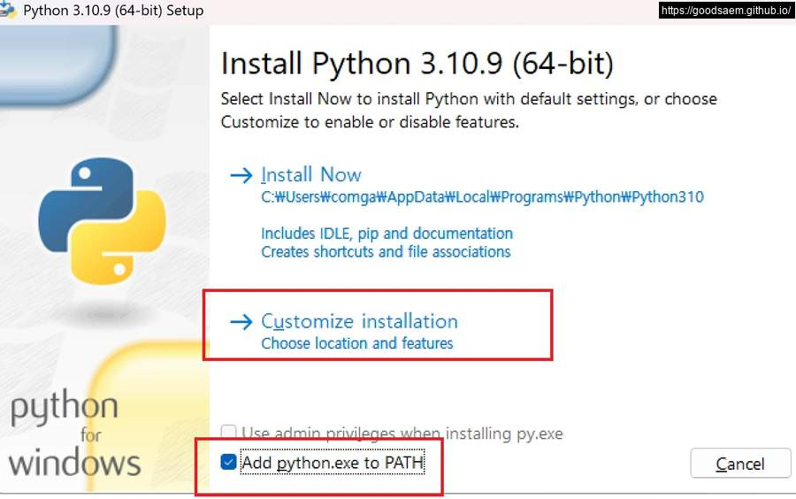
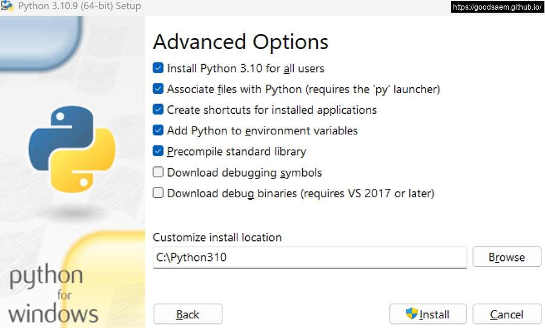
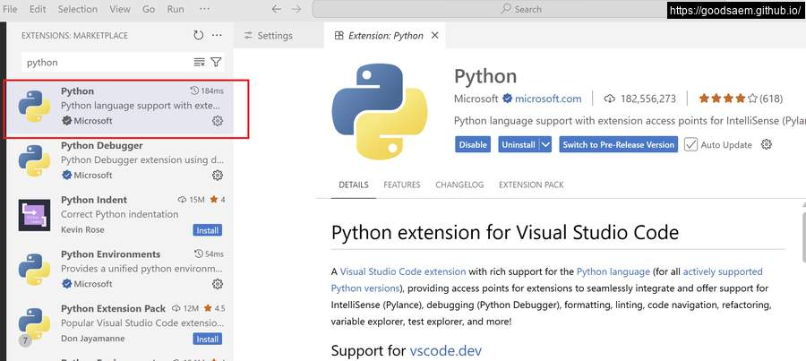
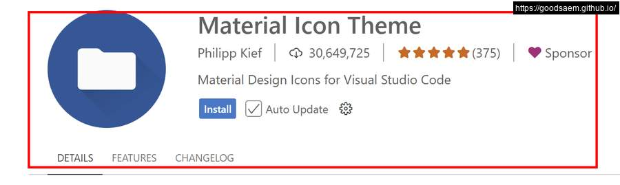
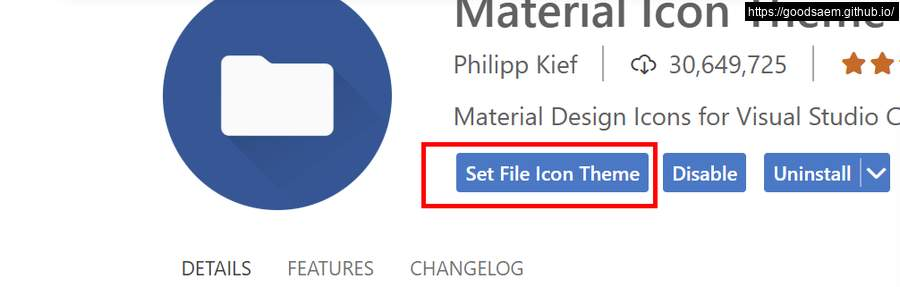
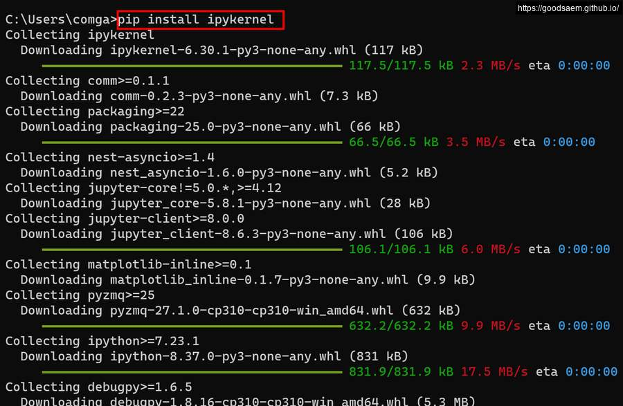
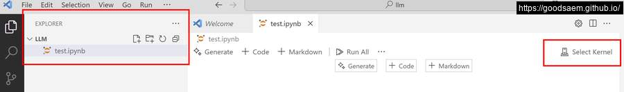
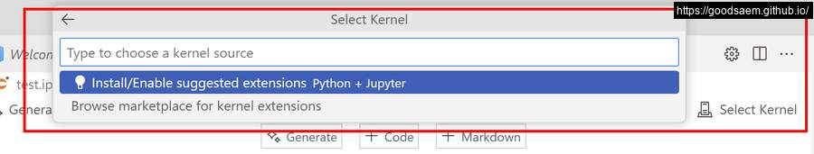
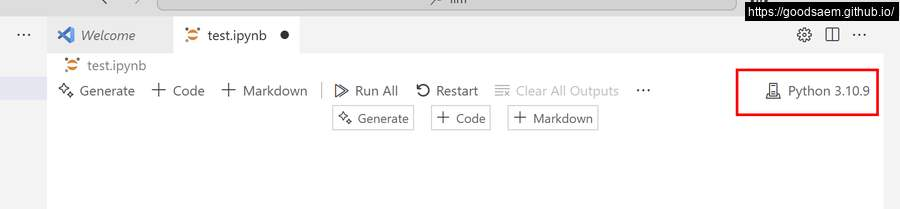
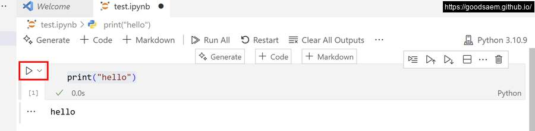

# 개발환경 구성

## 파이썬 설치

파이썬은 최신 버전을 설치하지 않는다 전전버전을 설치함
Python 3.10.9 설치

https://www.python.org/downloads/release/python-3109

- Add python.exe PATH 체크하고 Customize installation 클릭



- 경로를 지우고 C:\Python310 부분만 남기고 지운다. 그리고 설치 진행



## 비쥬얼 스튜디오 코드 설치

- 비쥬얼 스튜디오 코드를 설치하고 아래 플러그인을 설치한다.

- 파이썬 플러그인 설치



- material icon 설치



- 활성화



- 주피터 노트북 사용을 위해 아래 패키지 설치

```python
pip install ipykernel
```


# 쥬피터 노트북 설정
- test.ipynb 파일 생성
- Select Kernel 클릭
 

- Install/Enable 클릭하여 설치

 

- 설치가 완료되면 파이썬 3.10.9가 나와야 함

 

- 테스트 코드 작성 실행
 ```python
print("hello")
```

- 아래와 같이 결과가 나오면 개발을 위한 환경설정 완료



