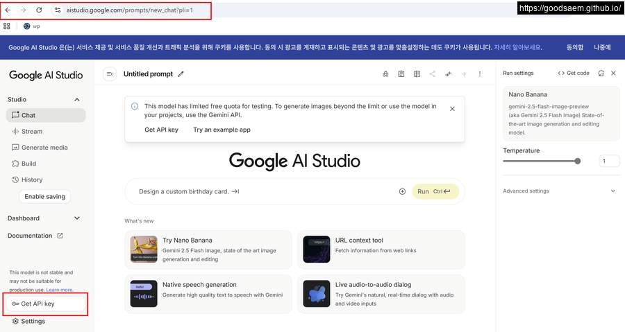
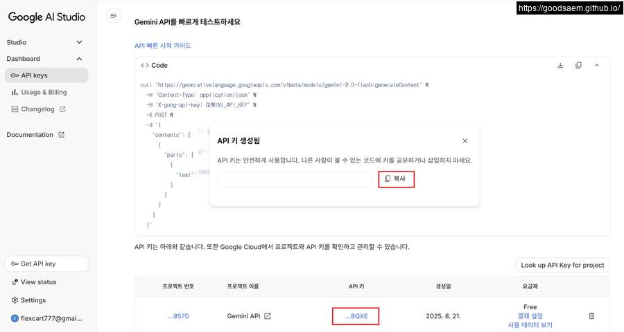
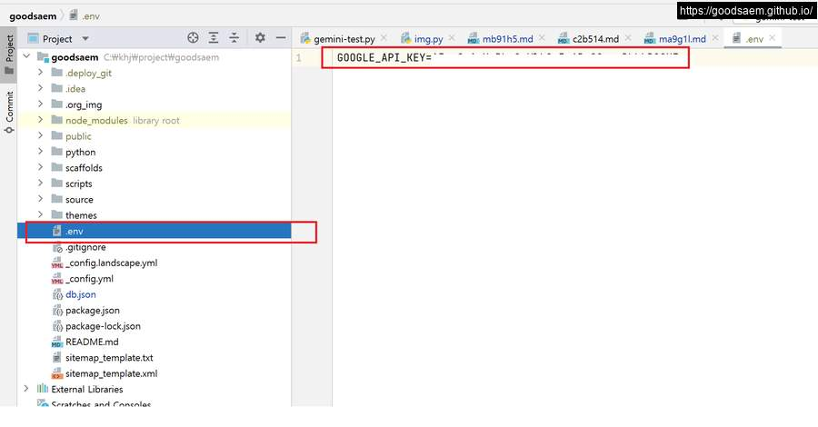


생성형 ai api 를 이용하여 화면 개발하는 방법에 대해 학습하기 위해 글을 정리한다
처음부터 돈을 주고 키를 발급받는것 보다는 무료로 제공되는 제미나이 api 키를 통해서
감을 익히고 돈주고 쓰는건 어느정도 익숙해 지면 진행하자


# 키발급

- 아래사이트에 접속하여 Get API key 버튼을 클릭하여 api 발급 확인한다.
  https://aistudio.google.com/prompts/new_chat?pli=1



- 프로젝트가 없으면 하나 만들고 api 키를 클릭하여 키를 복사한다. 요금제는 Free로




# 의존성 라이브러리 설치

- 테스트를 위해 아래 라이브러리를 설치한다
- dotenv는 api키를 숨기기 위해 사용하고 langchain 관련 라이브러리는 제미나이 api 사용을 위해 설치함
```python
pip install  dotenv
pip install langchain
pip install langchain_openai
```

# api 키 숨기기

github에 소스를 올릴텐데 키가 노출되면 안되므로 .env파일은 로컬에만 저장한다.

- 프로젝트 최 상단에 .env 파일을 만들고 아래와 같이 복사한 api 키를 붙여 넣기 한다.



- github에 키가 올라가지 않도록 .gitignore에 .env를 추가한다.

```properties
/.idea/
/node_modules/
/public/
/.deploy_git/
/.org_img/
/dist/
**/build/
*.exe
.env
```

# 테스트 1
```python
from langchain_openai import ChatOpenAI
from langchain.prompts import PromptTemplate
import warnings
import httpx
import os
from dotenv import load_dotenv
warnings.simplefilter("ignore")
client = httpx.Client(verify=False, timeout=30)

load_dotenv()
api_key = os.getenv("GOOGLE_API_KEY")

template = "{question}(500글자 이내로 답변)"
prompt = PromptTemplate.from_template(template=template)

gpt = ChatOpenAI(
  model="gemini-1.5-flash",
  temperature=0,
  base_url="https://generativelanguage.googleapis.com/v1beta/openai/",
  api_key=api_key,
  http_client=client,
)

final_prompt = prompt.format(question="gemini api 는 무엇인가?")
response = gpt.invoke(final_prompt)

print(response.content)

```

# 테스트1 결과
```bash
Gemini API는 구글에서 개발한 대규모 언어 모델(LLM)인 Gemini를 프로그래밍 방식으로 활용할 수 있도록 제공하는 인터페이스입니다.  다양한 작업을 수행할 수 있도록 설계되었으며, 텍스트 생성, 번역, 질문 응답, 코드 생성 등의 기능을 제공합니다.  개발자는 이 API를 사용하여 자체 애플리케이션이나 서비스에 Gemini의 강력한 기능을 통합할 수 있습니다.

Gemini API는 여러 가지 모델 크기와 기능을 제공하여 다양한 요구 사항을 충족합니다.  작은 모델은 속도와 효율성을 중시하는 애플리케이션에 적합하며, 큰 모델은 더욱 정교하고 복잡한 작업에 적합합니다.  또한, API는 다양한 프로그래밍 언어를 지원하여 개발자의 편의성을 높입니다.

Gemini API를 사용하면 다음과 같은 작업이 가능합니다.

* **텍스트 생성:**  이야기, 코드, 이메일, 기타 텍스트 형식을 생성합니다.
* **번역:**  한 언어에서 다른 언어로 텍스트를 번역합니다.
* **질문 응답:**  질문에 대한 답변을 생성합니다.
* **요약:**  긴 텍스트를 요약합니다.
* **분류:**  텍스트를 다양한 범주로 분류합니다.
* **코드 생성:**  프로그래밍 코드를 생성합니다.

Gemini API는 구글 클라우드 플랫폼을 통해 제공되며,  사용량에 따라 비용이 청구됩니다.  개발자는 API 문서와 다양한 예제 코드를 통해 Gemini API를 쉽게 학습하고 사용할 수 있습니다.  하지만,  모든 LLM과 마찬가지로,  Gemini API의 출력 결과는 항상 정확하거나 적절하지 않을 수 있으므로,  결과를 신중하게 검토하고 사용해야 합니다.


```

# 테스트2
```python
import os
import warnings

import httpx
from dotenv import load_dotenv
from langchain_openai import ChatOpenAI

warnings.simplefilter("ignore")
client = httpx.Client(verify=False, timeout=30)

load_dotenv()
api_key = os.getenv("GOOGLE_API_KEY")

gpt = ChatOpenAI(
    model="gemini-1.5-flash",
    temperature=0,
    base_url="https://generativelanguage.googleapis.com/v1beta/openai/",
    api_key=api_key,
    http_client=client,
)
msg = ''' 유지보수가 용이하게 아래코드를 리팩토링해줘 공통으로 사용되는 부분은 모듈로 따로 빼주고
from langchain_openai import ChatOpenAI
from langchain.prompts import PromptTemplate
import warnings
import httpx
import os
from dotenv import load_dotenv
warnings.simplefilter("ignore")
client = httpx.Client(verify=False, timeout=30)

load_dotenv()
api_key = os.getenv("GOOGLE_API_KEY")

template = "{question}(500글자 이내로 답변)"
prompt = PromptTemplate.from_template(template=template)

gpt = ChatOpenAI(
    model="gemini-1.5-flash",
    temperature=0,
    base_url="https://generativelanguage.googleapis.com/v1beta/openai/",
    api_key=api_key,
    http_client=client,
)

final_prompt = prompt.format(question="gemini api 는 무엇인가?")
response = gpt.invoke(final_prompt)

print(response.content)
'''
response = gpt.invoke(msg)

print(response.content)
```

# 테스트2 결과
```python
This refactored code separates concerns into modules for better maintainability and readability.  It also handles potential errors more gracefully.

**1. `config.py` (Configuration):**

```python
import os
from dotenv import load_dotenv

load_dotenv()  # Load environment variables from .env file

GOOGLE_API_KEY = os.getenv("GOOGLE_API_KEY")
if GOOGLE_API_KEY is None:
    raise ValueError("GOOGLE_API_KEY environment variable not set.")

API_BASE_URL = "https://generativelanguage.googleapis.com/v1beta/openai/"
```

**2. `gpt_client.py` (GPT Client):**

```python
import httpx
from langchain_openai import ChatOpenAI

class GPTClient:
    def __init__(self, api_key, base_url, model="gemini-1.5-flash", temperature=0):
        self.client = httpx.Client(verify=False, timeout=30)  #Consider using verify=True for production
        self.gpt = ChatOpenAI(
            model=model,
            temperature=temperature,
            base_url=base_url,
            api_key=api_key,
            http_client=self.client,
        )

    def invoke(self, prompt):
        try:
            response = self.gpt.invoke(prompt)
            return response.content
        except httpx.HTTPError as e:
            print(f"HTTP Error: {e}")
            return None
        except Exception as e:
            print(f"An error occurred: {e}")
            return None

```

**3. `prompt_templates.py` (Prompt Templates):**

```python
from langchain.prompts import PromptTemplate

def create_short_answer_prompt(question):
    template = "{question}(500글자 이내로 답변)"
    prompt = PromptTemplate.from_template(template=template)
    return prompt.format(question=question)

```

**4. `main.py` (Main Application):**

```python
from config import GOOGLE_API_KEY, API_BASE_URL
from gpt_client import GPTClient
from prompt_templates import create_short_answer_prompt

if __name__ == "__main__":
    gpt_client = GPTClient(api_key=GOOGLE_API_KEY, base_url=API_BASE_URL)
    prompt = create_short_answer_prompt("gemini api 는 무엇인가?")
    response = gpt_client.invoke(prompt)
    if response:
        print(response)

```

**Improvements:**

* **Modularity:** Code is split into logical units, making it easier to understand, test, and maintain.
* **Configuration:**  API key and base URL are managed in a separate configuration file, improving security and making it easier to change settings.
* **Error Handling:** The `GPTClient` now includes basic error handling to catch HTTP errors and other exceptions, preventing the program from crashing unexpectedly.  More robust error handling might be needed in a production environment.
* **Reusability:** The `GPTClient` and `prompt_templates` can be reused in other parts of your application.
* **Readability:** The code is more concise and easier to read.
* **`verify=False` Warning:** The `verify=False` argument in `httpx.Client` disables SSL certificate verification.  This is generally **insecure** and should only be used for development or testing.  For production, set `verify=True`.


Remember to create a `.env` file in the same directory as your `main.py` file and add your `GOOGLE_API_KEY` there:

```
GOOGLE_API_KEY=your_actual_api_key
```

This structure promotes better organization and makes future modifications and extensions much simpler.  Consider adding more sophisticated logging and error handling for a production-ready application.

```