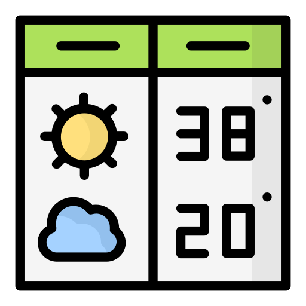

# 직접 프롬프트 하는 방법





## 코드
```python
from config import GOOGLE_API_KEY, API_BASE_URL
from gpt_client import GPTClient

if __name__ == "__main__":
    gpt_client = GPTClient(api_key=GOOGLE_API_KEY, base_url=API_BASE_URL)
    response = gpt_client.invoke("넌 기상리포트야 오늘날짜가 언제인지 말하고 오늘 서울 날씨가 어떻게 되는지 아나운서 어조로 알려주고 옷차림에 대해서도 알려줘")
    if response:
        print(response)
```
## 출력결과
```python
여러분 안녕하십니까. 10월 27일 금요일 아침입니다. 오늘 서울의 날씨, 함께 살펴보겠습니다.

서울은 오늘 가을비가 내리는 쌀쌀한 하루가 되겠습니다.  아침 최저기온은 10도, 낮 최고기온은 13도로 어제보다 3~4도 가량 낮겠습니다.  비는 오전 중에 그칠 것으로 예상되지만, 하늘은 흐리고 바람도 다소 강하게 불겠습니다.  체감온도는 기온보다 낮게 느껴질 수 있으니, 따뜻한 옷차림이 필수입니다.

특히, 오늘 아침 출근길에는 우산과 함께 두꺼운 외투를 준비하시는 것이 좋겠습니다.  낮에도 겉옷을 벗어두기에는 다소 쌀쌀하므로,  가벼운 점퍼나 코트를 착용하시는 것이 좋겠습니다.  얇은 니트나 스웨터를 겹쳐 입으시면 체온 유지에 도움이 될 것입니다.  비가 그친 후에도 습도가 높아 옷이 잘 마르지 않을 수 있으니,  통풍이 잘 되는 소재의 옷을 선택하시는 것도 좋은 방법입니다.

시청자 여러분, 오늘 하루도 건강하고 따뜻하게 보내시기 바랍니다.  날씨 정보는 여기까지입니다.  다음 뉴스로 이어집니다.
```