# 설치
- ① https://mariadb.org/ 접속한후 Download 버튼을 클릭한다.

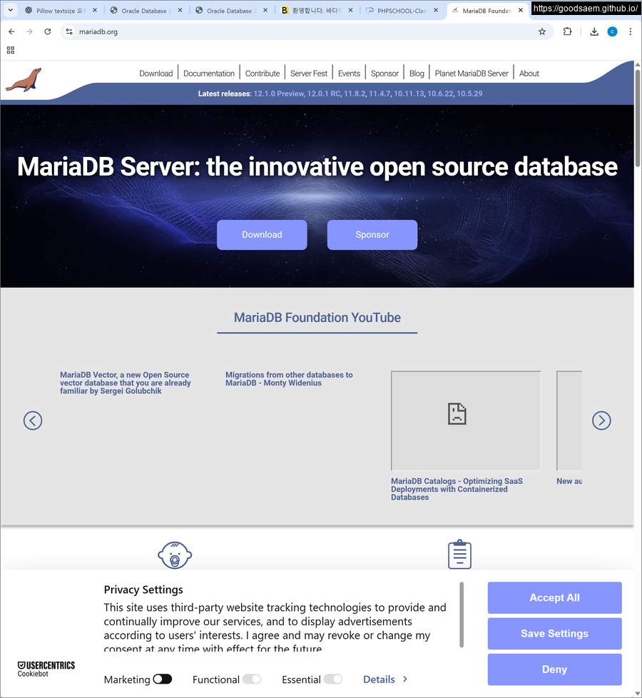

- ② 각자 환경에 맞는 파일을 선택한후 다운로드 버튼을 클릭한다.
1. MariaDB Server 11.8.2
2. Windows
3. x86_64
4. MSI Package

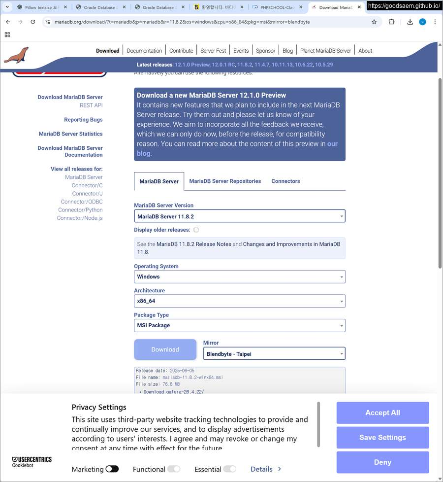

- ③ 다운로드 받은 파일을 더블클릭하여 설치 프로그램을 실행한다. Next 버튼 클릭

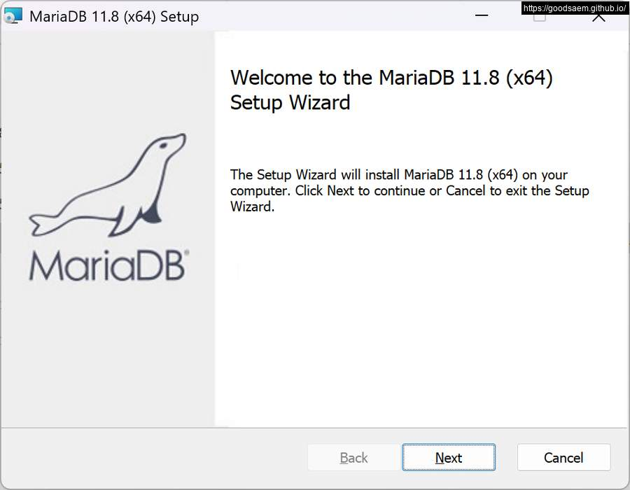

- ④ accept the terms in the License Agreement 체크한다. Next 버튼 클릭

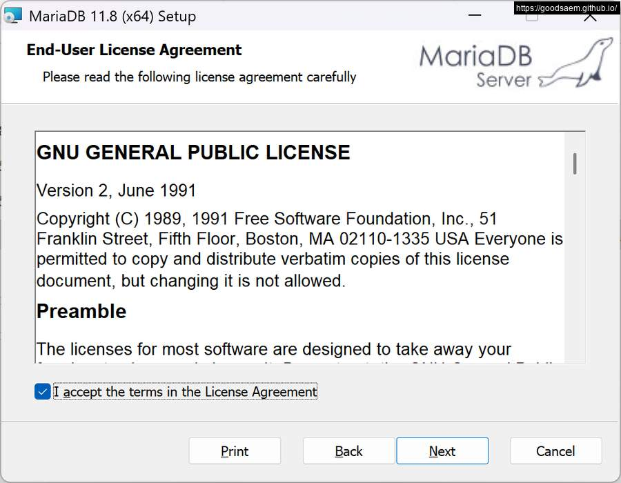

- ⑤ Location 변경후 Next 클릭 

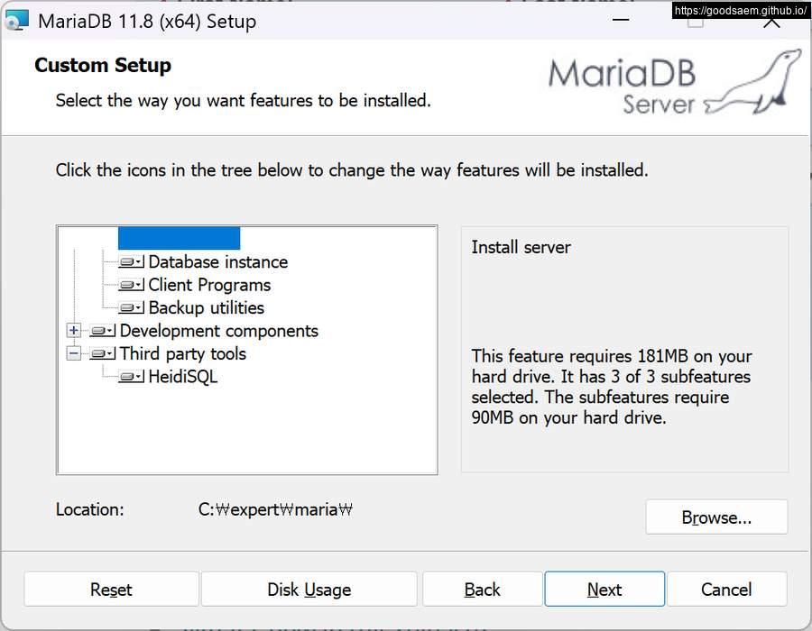

- ⑥ root에 사용할  password를 입력한후 Next 버튼 클릭

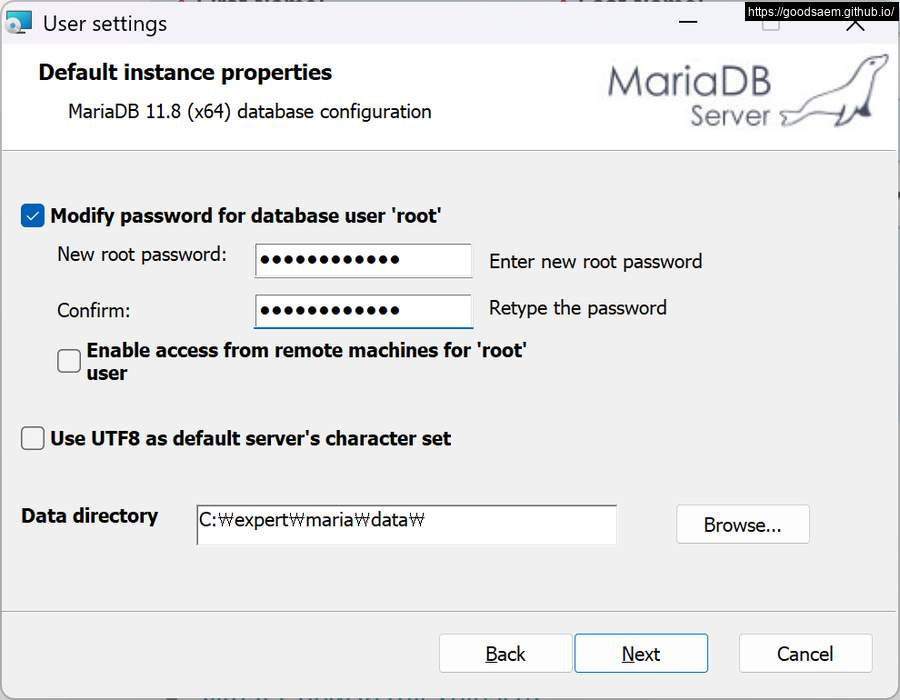

- ⑦ Next 버튼 클릭

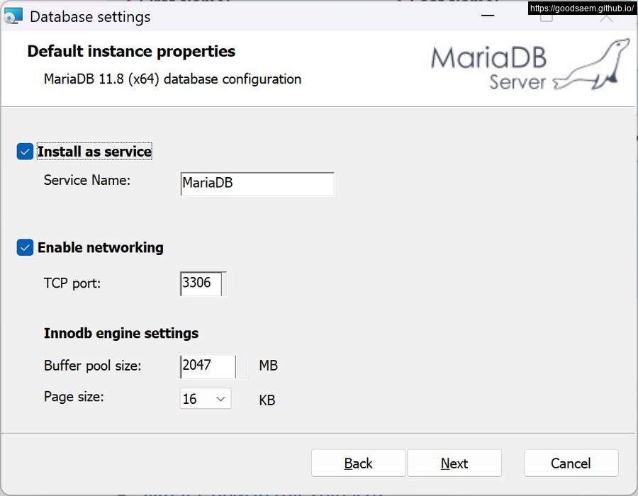

- ⑧ Install 버튼을 클릭한다.

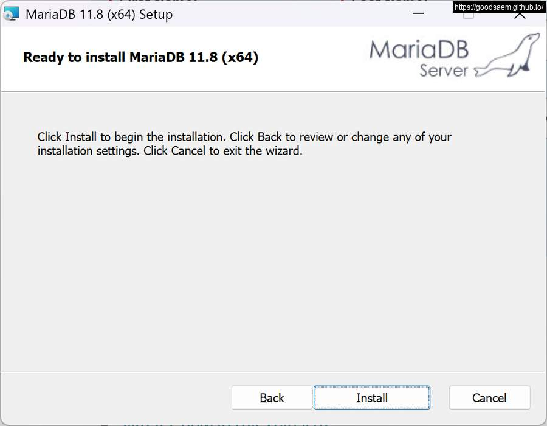

- ⑨ 설치 진행중

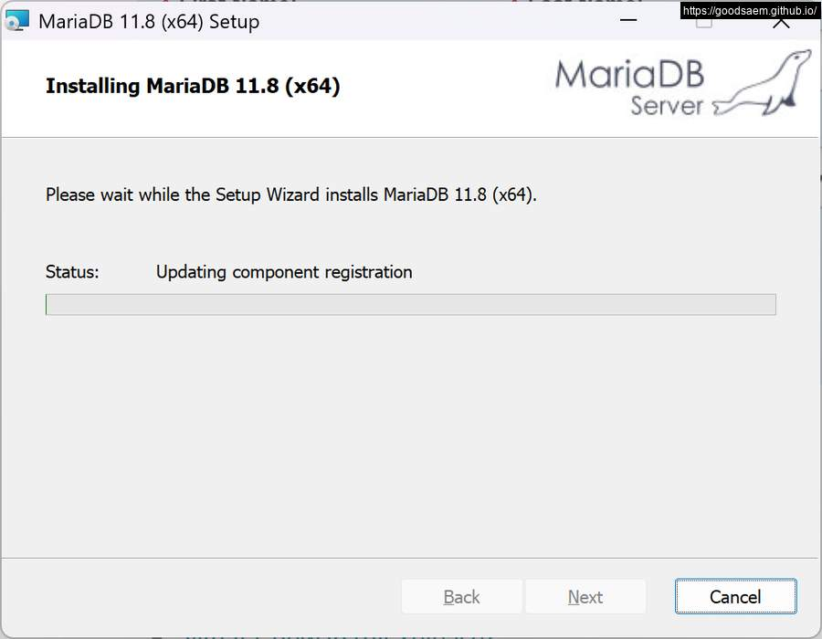

- ⑩ 설치완료 Finish 버튼을 클릭하여 완료

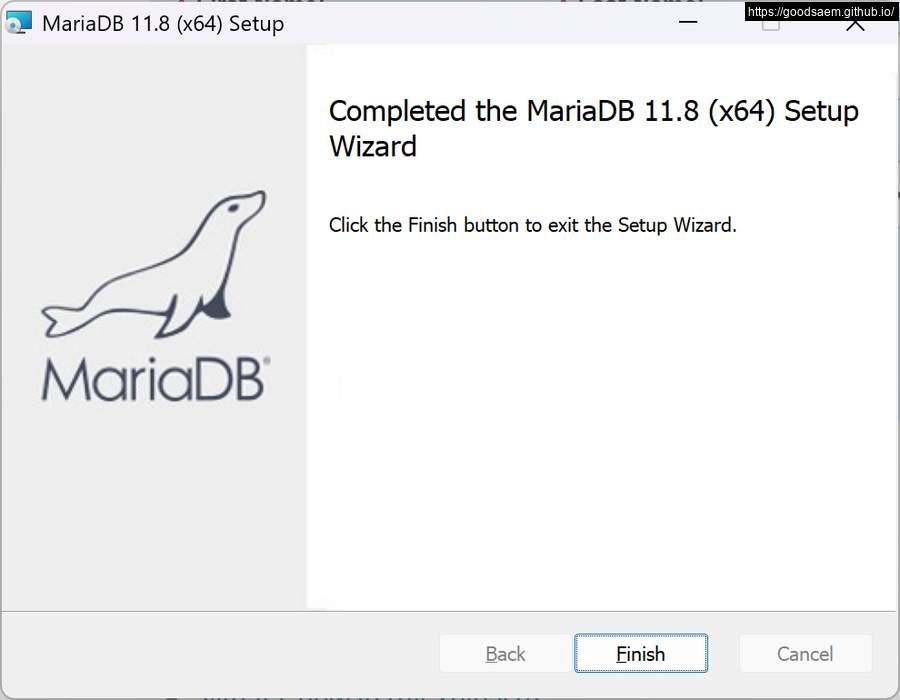

- ⑪ 설치시 함께 설치된 HeidiSQL을 실행

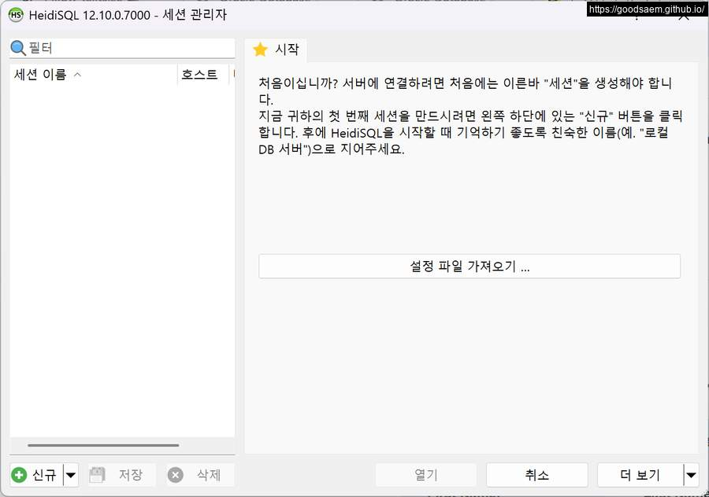

- ⑫ 신규 버튼을 클릭하여 root 패스워드를 입력하여 연결 버튼을 클릭

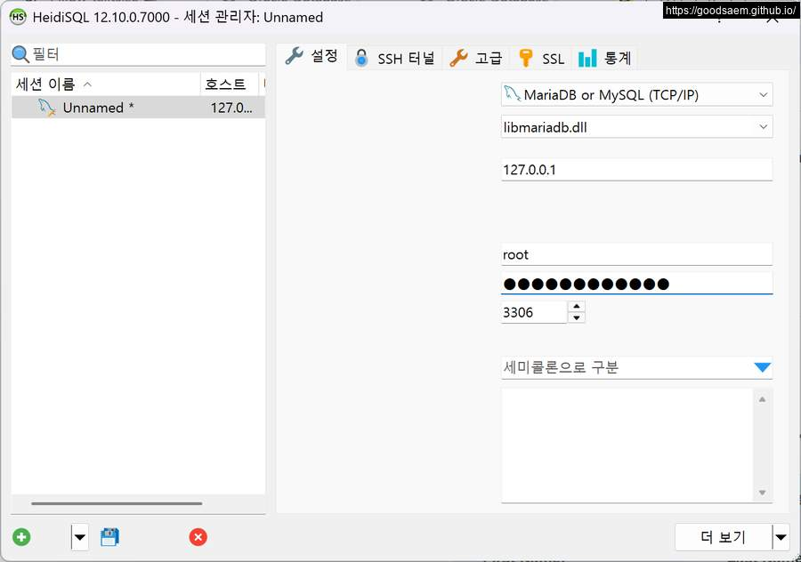

- ⑬ 아래와 같이 연결됨.

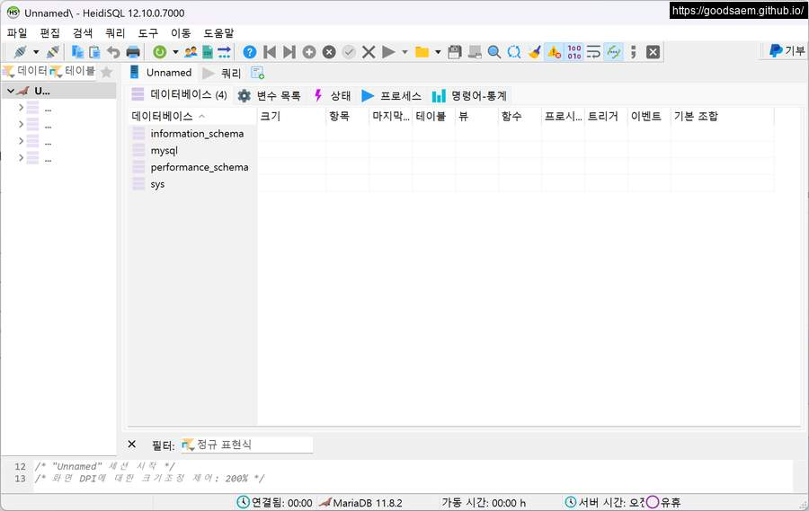

