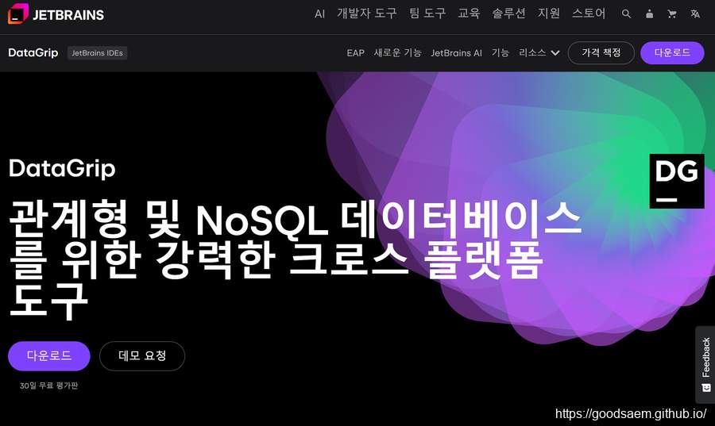

- 인텔이제이 DataGrip 에서 오라클 클라우드 연결하는 방법에 대해서 정리함



- ➕ 버튼을 클릭하고 Data Source를 클릭한후  Oracle을 선택한다.


- 최초 접속하면 드라이버를 다운로드 받는다.

- 아래와 같이 입력하고 Test Connection 을 클릭하면 성공적으로 연결된다. 
```bash
Name : Oracle
TNS name : goodsaem_high
User : admin
Password : XXXXXXX
URL : jdbc:oracle:thin:@goodsaem_high?TNS_ADMIN=C:/expert/Wallet_goodsaem
```


- 아래 쿼리 실행시 데이터가 출력되면 성공
```sql
select * from board
```

