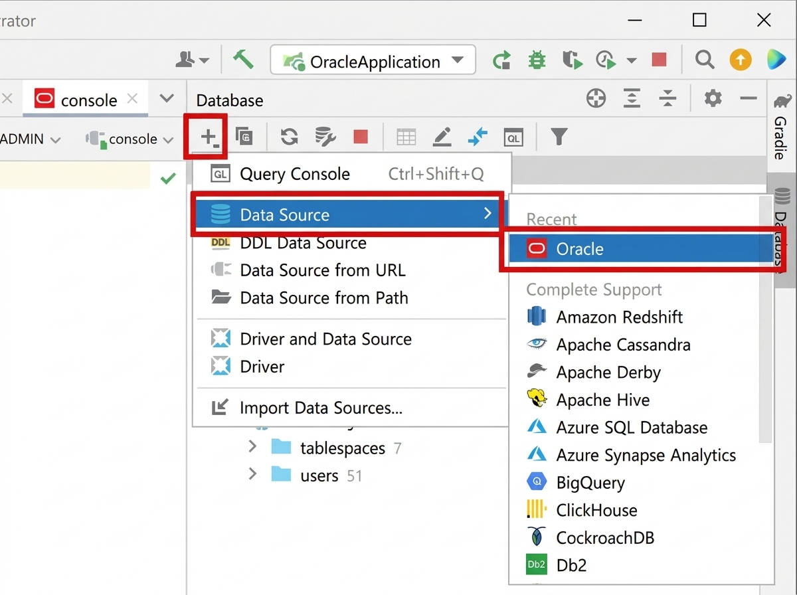
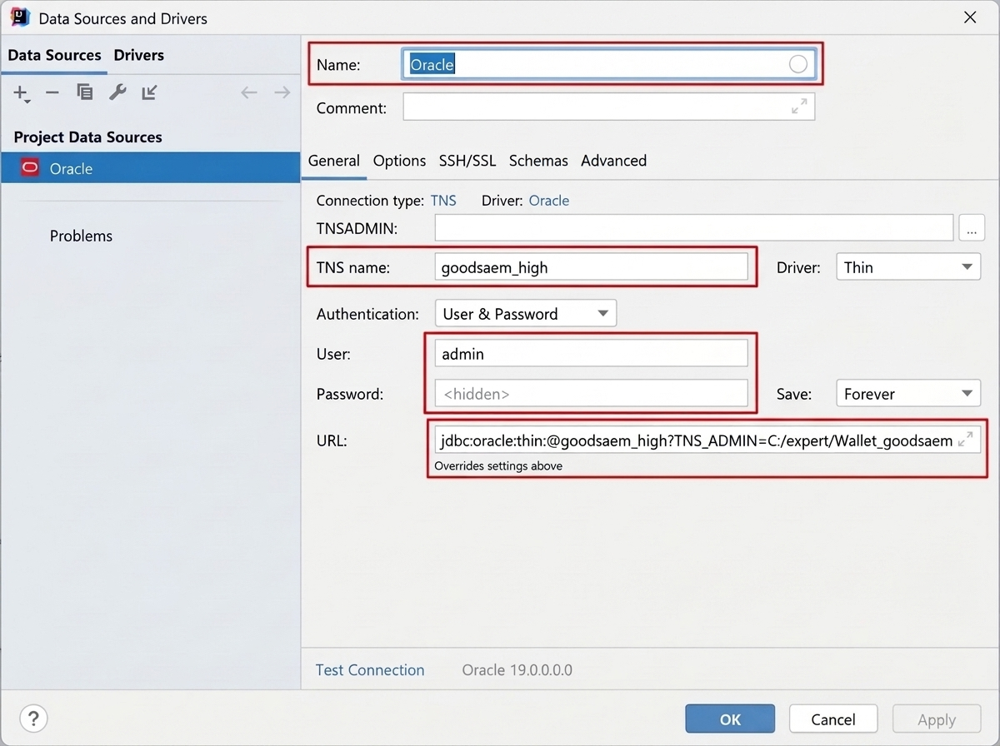
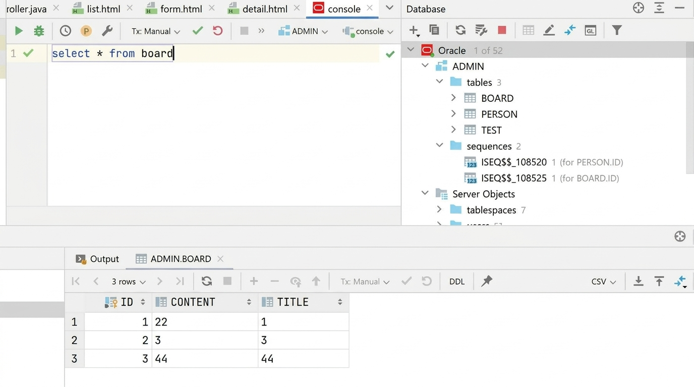

IntelliJ IDEA에 내장된 Database 도구(DataGrip)에서 Oracle Cloud(Autonomous Database)에 연결하는 과정을 정리했다. 오라클 클라우드 DB는 보안상 전자지갑(Wallet)을 통해 접속해야 하므로, 콘솔에서 미리 Wallet 압축 파일을 내려받아 로컬 경로(예: `C:/expert/Wallet_goodsaem`)에 풀어둔 상태에서 진행하면 된다.


## 1. Oracle Data Source 추가하기

IntelliJ 우측 `Database` 툴 윈도우에서 상단의 `+` 버튼을 누른 뒤 `Data Source` → `Oracle`을 선택한다.



처음으로 Oracle 연결을 설정하는 경우 창 하단에 드라이버 다운로드 안내가 표시된다. 클릭해서 Oracle JDBC 드라이버를 먼저 내려받는다.

## 2. 연결 정보 입력 및 테스트

`Data Sources and Drivers` 창이 열리면 `Connection type`이 `TNS`로 되어 있는지 확인하고, 아래 항목을 환경에 맞게 입력한다.

- **Name**: 구분하기 편한 연결 이름 (예: `Oracle`)
- **TNS name**: Wallet 폴더 내 `tnsnames.ora`에 정의된 서비스명 (예: `goodsaem_high`)
- **Driver**: `Thin`
- **Authentication**: `User & Password`
- **User / Password**: 접속할 DB 계정 정보 (예: `admin` / 비밀번호)
- **URL**: `jdbc:oracle:thin:@goodsaem_high?TNS_ADMIN=C:/expert/Wallet_goodsaem`

```text
Name     : Oracle
TNS name : goodsaem_high
User     : admin
Password : XXXXXXX
URL      : jdbc:oracle:thin:@goodsaem_high?TNS_ADMIN=C:/expert/Wallet_goodsaem
```

`URL` 항목을 직접 입력하면 입력란 아래에 `Overrides settings above` 안내가 표시되며, 상단 개별 필드 대신 JDBC URL 기준으로 접속을 시도한다. Windows 환경이라도 Wallet 경로는 역슬래시(`\`) 대신 슬래시(`/`)로 적어주는 편이 깔끔하게 인식된다.

입력을 마친 뒤 왼쪽 아래 `Test Connection`을 클릭해 연결 성공 메시지가 뜨면 `OK`를 눌러 저장한다.



## 3. 쿼리 실행으로 연결 확인하기

연결이 완료되면 `Database` 패널에서 스키마와 테이블 목록을 바로 확인할 수 있다. 쿼리 콘솔을 열어 간단한 조회 쿼리를 실행했을 때 하단 결과 탭에 데이터가 정상적으로 출력되면 설정이 끝난 것이다.

```sql
select * from board;
```

